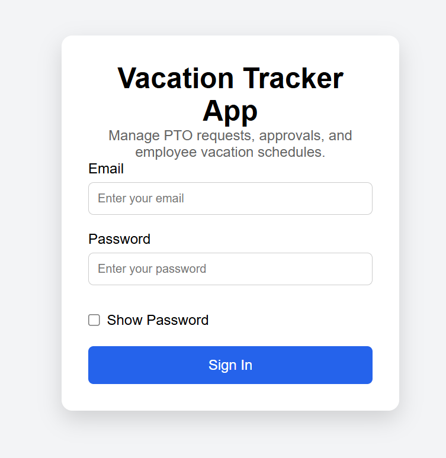
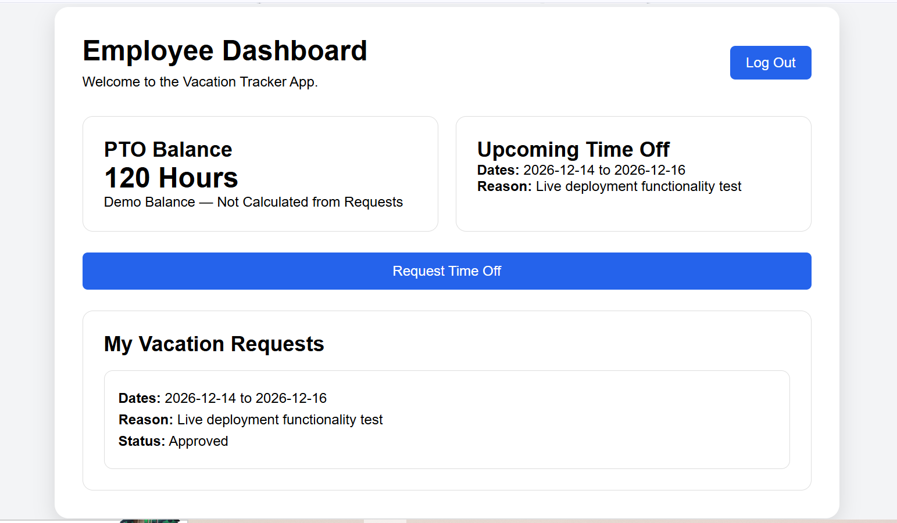
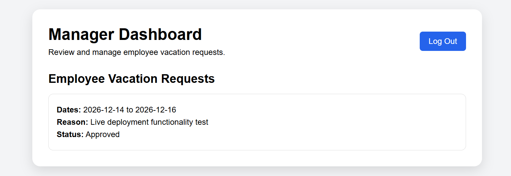

# Vacation Tracker App

A full-stack web application that allows employees to submit paid time off (PTO) and vacation requests while giving managers the ability to review, approve, or deny requests.

## Overview

The Vacation Tracker App is designed to streamline vacation request management within an organization.

Employees can submit vacation requests, view their request history, and track approval statuses. Managers can review employee submissions and approve or deny requests through a role-based dashboard.

The application integrates a React frontend with a Node.js/Express backend and PostgreSQL database to provide persistent data storage and authenticated access.

## Application Screenshots

### Login Screen

### Employee Dashboard

### Manager Dashboard

## Live Demo

**Application:** https://vacation-tracker-app.onrender.com

**GitHub Repository:** https://github.com/Henry-DensonJr33/Vacation-Tracker-App

### Demo Accounts

**Employee Login**
- Email: `employee@test.com`
- Password: `Employee123!`

**Manager Login**
- Email: `manager@test.com`
- Password: `Manager123!`

These accounts are intended for demonstration purposes. Please use fictional information when submitting requests.

*Note: The application is hosted on Render's free web service. Initial loading may take longer after a period of inactivity.*

## Key Features

### Employee Features
- Secure employee login
- Employee dashboard
- Submit vacation and PTO requests
- View submitted requests
- Track request status (Pending, Approved, Denied)
- View displayed PTO balance
- Log out securely

### Manager Features
- Secure manager login
- Manager dashboard
- Review employee vacation requests
- Approve or deny submitted requests
- View request information and approval statuses
- Log out securely

### Backend and Database
- REST API built with Node.js and Express
- PostgreSQL relational database
- Persistent vacation request storage
- Password hashing with bcrypt
- JWT-based authentication using HTTP-only cookies
- Role-based authorization

## Technologies

| Category | Technologies |
|---|---|
| Frontend | React, Vite, JavaScript, HTML, CSS |
| Backend | Node.js, Express.js |
| Database | PostgreSQL |
| Authentication | JWT, bcrypt |
| Deployment | Render |
| Version Control | Git, GitHub |

## Project Status

**Deployed and Functional**

The application is publicly accessible through Render.

Core employee and manager workflows have been successfully tested, including authentication, vacation request submission, manager approval, and database persistence.

## Future Enhancements

- Email notifications
- Company holiday calendar
- Automated PTO accrual and balance calculations
- Team vacation calendar
- Additional administrative tools
- Further mobile interface improvements

## Developer

**Henry Denson Jr.**

GitHub: https://github.com/Henry-DensonJr33